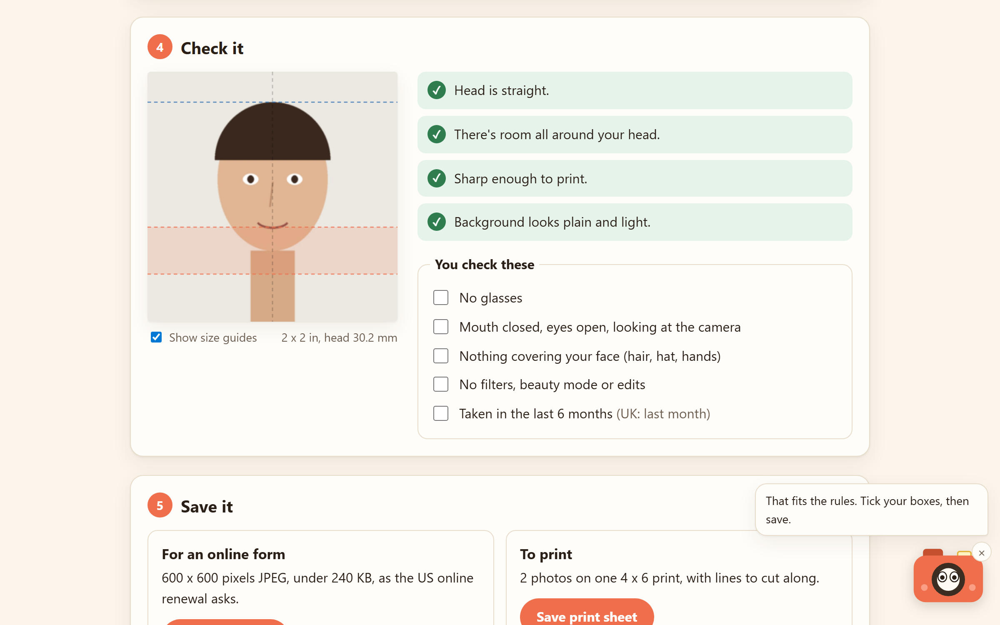

# Snapsize

Turn a phone photo into a passport or visa photo at the exact size. Pick the document, add a photo, drag two lines to the top of your head and your chin, and Snapsize cuts it so the head lands in the size the rules ask for. It checks the result, then saves a file for online forms and a 4 x 6 print sheet you can order at any photo counter. Flash the camera helps along the way.

**Try it:** https://snapsize.johanthegoat.xyz



## Why

- Store passport photos cost around $15 to $18 for two prints (Walgreens $16.99, CVS $17.99 per [these](https://www.smartphone-id.com/en-us/passport-photo-cost) [price guides](https://www.thepricer.org/how-much-does-a-passport-photo-cost-at-walgreens/)), while a same-day 4 x 6 print is about 16 cents at [Walmart](https://photos3.walmart.com/about/prints).
- Head size is the rule people miss most. The US wants the head 1 to 1 3/8 in on a 2 x 2 in photo ([State Department composition template](https://travel.state.gov/content/travel/en/us-visas/visa-information-resources/photos/photo-composition-template.html)), the UK 29 to 34 mm on 35 x 45 mm ([GOV.UK](https://www.gov.uk/photos-for-passports/photo-requirements)). A crop that "looks right" is easy to get wrong by a few millimetres.
- Online forms want their own pixel sizes: at least 600 x 750 for the UK ([GOV.UK digital photos](https://www.gov.uk/photos-for-passports)).

## What you can do

- Choose **US passport or visa** (2 x 2 in), **UK passport** (35 x 45 mm), **EU passport or Schengen visa** (35 x 45 mm, head 32 to 36 mm), **Canada passport** (50 x 70 mm, head 31 to 36 mm, from the [Government of Canada spec](https://www.canada.ca/en/immigration-refugees-citizenship/services/new-immigrants/pr-card/apply-renew-replace/photo.html)), **Australia passport** (35 x 45 mm, face 32 to 36 mm chin to crown, per the [DFAT photo guidelines](https://hcmc.consulate.gov.au/files/hchi/Passport%20photo%20guidelines%2020250519.pdf)), **India passport or visa** (2 x 2 in / 51 mm, head 25 to 35 mm, per the [Embassy of India photo spec](https://www.eoiparis.gov.in/content/Photo-Specification-of-passport.pdf)), **Japan passport** (35 x 45 mm, crown to jaw 34 ± 2 mm, per the [Japanese embassy photo spec](https://www.mofa.go.jp/mofaj/toko/passport/pass_4.html)) or **New Zealand passport** (35 x 45 mm, head 32 to 36 mm, per [passports.govt.nz](https://www.passports.govt.nz/passport-photos/)).
- Drag the **top of head** and **chin** lines on your photo, with a mouse, a finger or the arrow keys. Moving one sideways centres the face.
- See the finished photo live, with guides showing where your chin has to land.
- Get plain checks: head straight, room around the head, sharp enough to print, and a background check that catches dark walls, a shadow on one side and busy backgrounds.
- Tick off the things only you can check: no glasses, neutral face, nothing covering it, no filters, taken recently.
- **Save photo file:** a JPEG at the size forms ask for. The US file is kept under 240 KB.
- **Save print sheet:** a 300 dpi 4 x 6 with as many photos as fit (two US, six 35 x 45) and lines to cut along.

## Meet Flash

Flash is a little camera in the corner. Its eyes follow your mouse, or whatever you tap on a phone. Its face follows the checks: happy when everything fits, worried when something needs fixing. Tap it for a tip for the step you're on; tap five times fast and the flash goes off. It reacts when you pick a document, add a photo, finish marking and save. You can tuck it away with the ×, and it remembers. Everything it says goes through a live region, so screen readers hear it too, and it holds still if your device asks for reduced motion.

## How it works

**Size from two marks.** The crown and chin marks give the head height in source pixels. Snapsize aims for the middle of the allowed range (30.2 mm for the US), so `pxPerMm = headPx / 30.2`, and the crop is the document size times that. 30% of the space the head doesn't use goes above it. On a US photo that puts the eyes 29.6 mm from the bottom, inside the template's 1 1/8 to 1 3/8 in band (there's a test for it).

**Checks you can trust.** The room check measures how much of the crop has no photo under it, per side, and says which side ran out. The sharpness check compares source pixels per millimetre with the 11.8 px/mm a 300 dpi print needs. The background check renders a small copy, reads two strips beside the head and looks at brightness, spread, and the gap between the two sides (a shadow).

**Under 240 KB without guessing.** Encoding is a binary search over JPEG quality (six steps between 0.5 and 0.95) that keeps the best quality that still fits.

**Print sheet.** The layout tries the paper both ways round with a 3 mm margin and 3 mm cut gaps and keeps whichever fits more photos. Cut lines are drawn edge to edge, then the photos are drawn again over them so the lines only show in the gaps.

## Run it

Open `index.html` in a browser. No build step, no dependencies.

```bash
npm test
```

The tests cover every document size, head size after cropping, the US eye band, running out of photo, low detail, tilt, the background check, print sheet packing (no overlaps, inside the paper) and the JPEG size search.

## Files

- `src/core.js`: sizes, crop maths, checks, print layout. No DOM, runs in Node.
- `src/app.js`: the page.
- `src/flash.js`: Flash.
